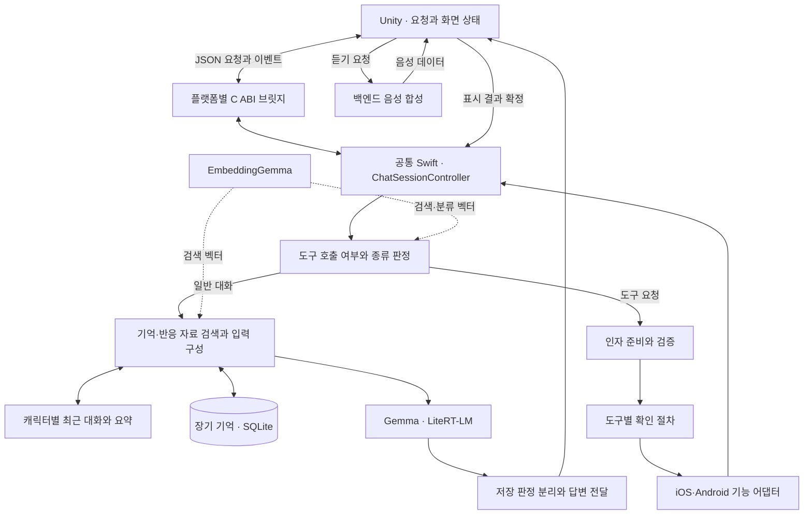
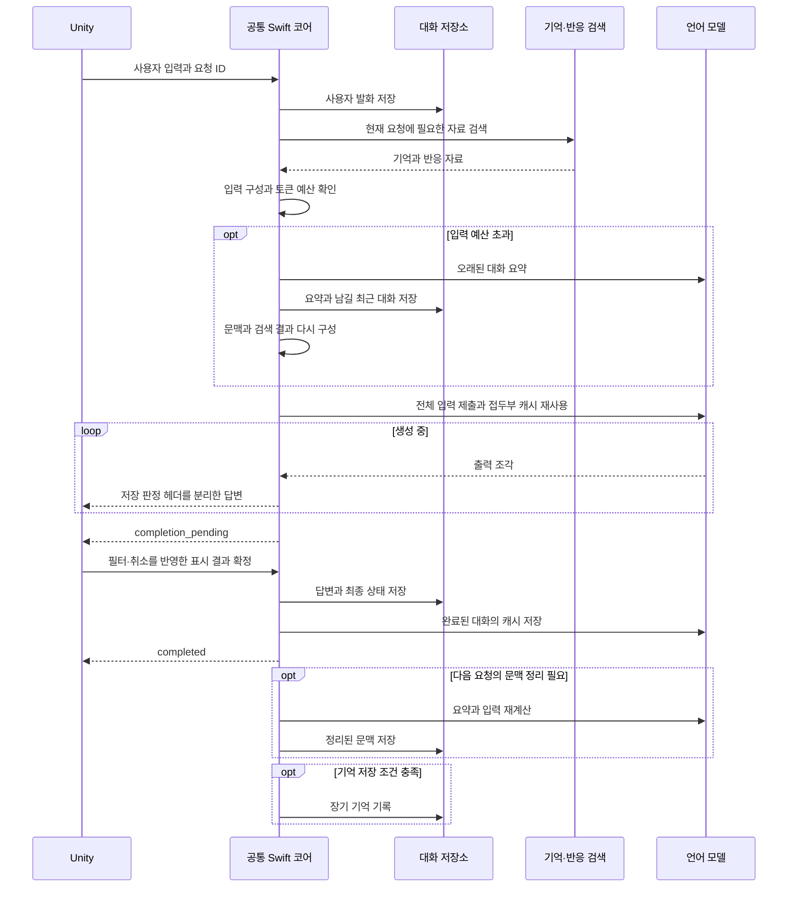

별무리는 Unity에서 받은 대화 요청을 공통 Swift 코어에서 처리합니다. iOS와 Android는 입력 구성, 기억 검색, 답변 생성과 요청 상태 관리를 공유합니다. 모델 파일을 준비하거나 기기 기능을 실행하는 부분은 플랫폼별 어댑터로 연결합니다.

<nav class="doc-card-group" aria-label="주요 처리 경로의 상세 문서">
  <a class="doc-card" href="?doc=dialogue-response-construction" aria-labelledby="architecture-dialogue-title">
    <svg class="doc-card-icon" viewBox="0 0 24 24" aria-hidden="true"><path d="M21 11a8 8 0 0 1-8 8H7l-5 3V11a9 9 0 0 1 19 0ZM7 9h10M7 13h6"/></svg>
    Response construction
    응답 지침과 대화 문맥을 모델 입력으로 구성하고, 생성한 답변을 전달합니다.
    →
  </a>
  <a class="doc-card" href="?doc=memory-memory" aria-labelledby="architecture-memory-title">
    <svg class="doc-card-icon" viewBox="0 0 24 24" aria-hidden="true"><ellipse cx="12" cy="5" rx="8" ry="3"/><path d="M4 5v14c0 1.7 3.6 3 8 3s8-1.3 8-3V5M4 12c0 1.7 3.6 3 8 3s8-1.3 8-3"/></svg>
    Memory
    최근 대화와 장기 기억의 보관 범위, 저장 시점과 검색 경계를 설명합니다.
    →
  </a>
  <a class="doc-card" href="?doc=tool-use-request-routing" aria-labelledby="architecture-tools-title">
    <svg class="doc-card-icon" viewBox="0 0 24 24" aria-hidden="true"><path d="M5 3v14a4 4 0 0 0 4 4h10M5 9h10a4 4 0 0 0 4-4V3M16 18l3 3-3 3"/></svg>
    Request routing
    일반 대화와 기기 기능 요청을 구분하고, 실행할 도구를 선택합니다.
    →
  </a>
</nav>

## System overview

Unity는 사용자 입력과 앱 상태를 보내고 답변 이벤트를 받습니다. 공통 코어의 `ChatSessionController`는 한 요청의 진행 상태를 관리하며, 일반 대화와 도구 실행의 처리 순서를 정합니다.

Gemma는 대화 답변과 도구 인자를 생성합니다. EmbeddingGemma는 기억 검색, 반응 자료 검색과 도구 분류에 필요한 벡터를 만듭니다. 언어 모델과 임베딩 모델은 기기에서 실행됩니다. 듣기 기능은 별도로 발화 텍스트를 백엔드에 보내 합성된 음성을 받습니다.

## Shared core and platform adapters

| 계층 | 역할 |
| --- | --- |
| Unity 대화 세션 | 입력 필터, 화면 출력, 취소와 표시 결과 확정을 담당합니다. |
| 공통 Swift 코어 | 대화 기록, 검색, 입력 구성, 생성과 도구 실행 상태를 관리합니다. |
| 추론 런타임 | LiteRT-LM 엔진과 캐시 세션을 관리하고 토큰 수를 측정합니다. |
| 플랫폼 어댑터 | 모델 파일 위치, 저장 경로, 권한과 기기 기능 호출을 제공합니다. |

Unity의 `IChatRuntime` 구현은 요청을 JSON으로 직렬화하고 네이티브 함수를 호출합니다. iOS는 Objective-C++ 래퍼를 통해 Swift로 연결하며, Android는 네이티브 라이브러리의 C 함수를 통해 같은 코어를 호출합니다. 결과 콜백은 Unity 이벤트 큐에 들어갑니다.

요청 이벤트에는 식별자가 붙습니다. Unity는 현재 요청의 식별자와 대조해 늦게 도착한 다른 요청의 답변을 걸러 냅니다. 모델 준비 상태는 별도로 전달합니다.

## Conversation pipeline

일반 대화에서는 현재 발화와 관련 있는 장기 기억을 찾고, 응답 방식의 참고 자료를 검색합니다. 반응 검색기는 현재 발화만 사용할지 최근 메시지까지 포함할지 먼저 고른 다음, 가장 가까운 반응 자료 하나를 선택합니다. 조건에 맞는 배경 설정과 현재 화두 정보도 입력에 포함할 수 있습니다.

입력은 고정 지침, 대화 요약과 최근 이력, 이번 요청의 동적 문맥, 검색한 기억과 현재 발화 순으로 구성합니다. 각 묶음의 시스템·사용자 역할은 네이티브 대화 템플릿에 전달할 때도 유지합니다. 고정된 부분을 앞에 배치하면 다음 요청에서 같은 토큰 접두부의 KV 캐시를 재사용할 수 있습니다.

모델이 생성을 마쳐도 Unity에 남아 있는 출력 이벤트나 사용자의 취소 요청이 아직 처리 중일 수 있습니다. Swift는 완료 예정 이벤트를 보내고 Unity의 표시 결과를 받은 뒤 대화를 확정합니다. 출력 필터가 답변을 차단했다면 빈 답변으로 취소를 확정해 차단된 텍스트가 대화 기록에 남지 않게 합니다.

`completed`는 해당 답변의 완료를 뜻합니다. 이후 문맥 정리나 장기 기억 저장이 이어질 수 있으므로, 다음 입력 가능 여부는 런타임 상태도 함께 확인합니다.

## Conversation state

캐릭터마다 대화 파일과 요약을 따로 보관합니다. 캐릭터를 전환할 때는 대상 설정과 기록을 읽고 대화 세션을 준비하며, 로드된 언어 모델과 임베딩 모델은 유지합니다. 생성·요약·도구 확인 등 진행 중인 작업이 있으면 전환을 거부합니다.

최근 문맥은 토큰 예산에 따라 관리합니다. 예산을 넘으면 최근 3개 요청에 해당하는 문맥을 우선 남기고, 빠지는 부분과 기존 요약을 합쳐 최대 500토큰으로 요약합니다. 남길 대화도 길면 더 줄입니다. 장기 기억은 별도 SQLite 저장소에서 현재 발화와의 관련성으로 검색합니다.

대화 요약, 장기 기억과 KV 캐시의 역할은 [Memory](?doc=memory-memory)와 [KV Cache Reuse and Persistence](?doc=optimization-kv-cache)에서 설명합니다.

## Tool pipeline

도구 라우팅은 실행 요청 여부를 MLP로 판정합니다. 통과한 발화는 한국어 규칙에 맞는 도구가 있으면 그 결과를 사용하고, 그렇지 않으면 도구별 대표 벡터와 비교합니다. 여러 도구가 동시에 선택되면 실행 대신 요청을 나누도록 안내합니다.

선택한 도구가 플랫폼에서 지원되고 현재 세션에서 허용되는지 확인합니다. 인자가 필요한 도구는 언어 모델이 값을 생성하고 Swift가 형식과 범위를 검증합니다. 현재 시각 조회와 알람 목록 조회는 고정 인자를 사용합니다.

현재 시각 조회는 추가 확인 없이 실행합니다. 나머지 도구는 확인 화면을 거치며, 사용자가 값을 바꾸면 다시 검증합니다. 실행 결과는 기기 어댑터가 반환한 값으로 구성합니다. 도구 응답도 최근 대화에는 남지만, 일반 대화의 장기 기억 검색·저장 경로는 거치지 않습니다.

## Runtime lifecycle

모델 준비에는 파일 확인, 대화·검색 자원 로드, 언어 모델 초기화, 임베딩 서비스와 도구 라우터 준비가 포함됩니다. iOS는 CPU 추론을 사용합니다. Android는 CPU·GPU 선택을 지원하며 설정 변경은 앱 재시작 후 적용합니다.

iOS는 모델 로드 전에 운영체제가 보고한 프로세스의 메모리 여유를 확인합니다. 정책 기준에 미달하면 준비를 보류하고 내부 상태를 `preparationDeferred`로 두고 `model_memory_insufficient` 오류를 전달합니다. 파일을 다시 내려받는 대신 재시도 시점의 메모리 여유를 다시 확인합니다.

| 실패한 단계 | 처리 |
| --- | --- |
| 대화·반응 검색 자원 로드 | 대화 준비를 실패로 처리합니다. |
| 장기 기억 검색 | 오류를 기록하고 검색 기억 없이 대화를 계속합니다. |
| 도구 라우터 준비·분류 | 일반 대화로 처리하고 라우터 오류를 기록합니다. |
| 대화 요약 생성 | 경고를 전달하고 예산에 맞는 최근 대화로 이어갑니다. |
| 문맥 파일 저장·입력 재계산 | 대화 준비를 실패로 처리합니다. |
| 장기 기억 저장 | 완료한 답변을 유지하고 저장 오류를 기록합니다. |

SQLite 연결은 모델 실행 자원과 별도로 관리합니다. 모델을 해제하거나 다시 준비하는 과정에서 기억 저장소의 연결을 교체하지 않습니다.
