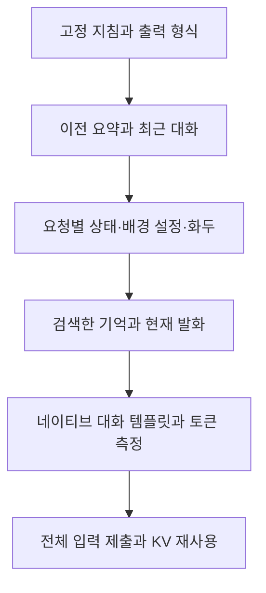

대화 입력에는 현재 발화 외에도 응답 지침, 앞선 대화, 검색한 기억과 반응 자료가 들어갑니다. 입력 구성부는 각 자료의 역할과 순서를 정하고, 모델이 처리할 수 있는 길이인지 확인합니다. 제품과 평가 실행부는 같은 Swift 입력 구성 코드를 사용합니다.

## Input order

고정 지침과 출력 형식은 첫 시스템 메시지에 모읍니다. 대화 요약과 이력은 역할을 표시한 텍스트로 묶고, 요청마다 바뀌는 상태와 설정은 이력 뒤에 배치합니다. 검색 자료에는 삽입 위치 규칙도 적용하므로 반응 참고 자료처럼 대화 이력 안에 들어가는 항목이 있습니다.

시스템·사용자 메시지의 역할은 모델의 대화 템플릿에 전달할 때 유지합니다. 텍스트가 같더라도 역할과 배치가 달라지면 입력 토큰이 달라질 수 있습니다. 앞부분의 고정 지침을 유지하는 것은 [KV 캐시 재사용](?doc=optimization-kv-cache)에도 필요합니다.

## Retrieved context

장기 기억은 현재 발화와 관련된 사용자 기록입니다. 반응 자료는 답변의 목표와 표현 방식을 참고하기 위해 미리 만든 자료입니다. 배경 설정은 조건에 따라 선택하는 설명 자료입니다. 입력 구성부는 이 자료들을 각 용도에 맞는 위치에 넣습니다.

반응 검색은 현재 메시지 1개 또는 현재 메시지를 포함한 최근 3개 메시지를 검색 입력으로 사용합니다. 선택 방식은 [Reaction retrieval](?doc=dialogue-scene-routing)에서 설명합니다.

홈 화면에서 대화로 가져온 화두에는 표시한 문장과 주제 정보가 함께 저장됩니다. 주제 정보는 해당 화두가 최근 문맥에 남아 있는 동안 답변 입력에 포함됩니다. 문맥을 정리해 그 화두가 빠지면 주제 정보도 함께 제외합니다.

## Token budget and summary

모델의 토크나이저와 대화 템플릿으로 전체 입력 길이를 측정합니다. 출력 공간을 예약한 뒤 입력이 남은 용량을 넘으면 오래된 문맥을 정리합니다. 기존 요약과 제외할 대화를 새 요약으로 합치고, 최근 요청은 원문으로 남깁니다.

요약한 입력은 다시 측정하고 모델에 미리 입력해 계산합니다. 이후 대화 파일과 캐시를 저장합니다. 요약 생성만 실패한 경우에는 경고를 보내고 최근 문맥으로 이어가지만, 저장이나 모델의 입력 계산에 실패하면 준비 실패 상태로 전환합니다.

세부 예산은 [Context and Latency](?doc=optimization-context-and-latency)에서 설명합니다.

## Output and finalization

일반 대화의 출력에는 기억 저장 판정과 표시할 답변이 함께 들어옵니다. Swift는 저장 판정 헤더를 분리한 뒤 답변 조각을 Unity에 전달합니다. 판정만 있고 본문이 비어 있으면 답변 생성을 한 번 더 시도합니다.

Unity는 출력 필터와 취소 상태를 확인하고, 최종적으로 표시한 답변을 Swift에 알려 줍니다. Swift는 이 결과로 대화 파일을 확정합니다. 취소 중에 생성이 끝나더라도 화면에 표시하지 않은 답변 전체를 저장하지 않도록 하는 절차입니다.

완료된 일반 대화는 저장 판정에 따라 사용자 원문을 장기 기억으로 기록할 수 있습니다. 최근 이력, 요약과 장기 기억의 수명은 [Memory](?doc=memory-memory)에서 설명합니다.

<nav class="doc-card-group" aria-label="대화 지침과 평가의 상세 문서">
  <a class="doc-card" href="?doc=dialogue-scene-routing" aria-labelledby="dialogue-scenes-title">
    <svg class="doc-card-icon" viewBox="0 0 24 24" aria-hidden="true"><path d="m12 3 10 5-10 5L2 8l10-5ZM2 12l10 5 10-5M2 16l10 5 10-5"/></svg>
    Reaction retrieval
    반응 자료를 찾을 때 최근 대화를 포함할지 결정하는 기준을 설명합니다.
    →
  </a>
  <a class="doc-card" href="?doc=dialogue-evaluating-consistency" aria-labelledby="dialogue-evaluation-title">
    <svg class="doc-card-icon" viewBox="0 0 24 24" aria-hidden="true"><path d="M4 3v18h17M9 16v-5M14 16V7M19 16V4"/></svg>
    Evaluating consistency
    설정을 유지하는 응답과 불필요한 정정을 짝지어 평가합니다.
    →
  </a>
</nav>
