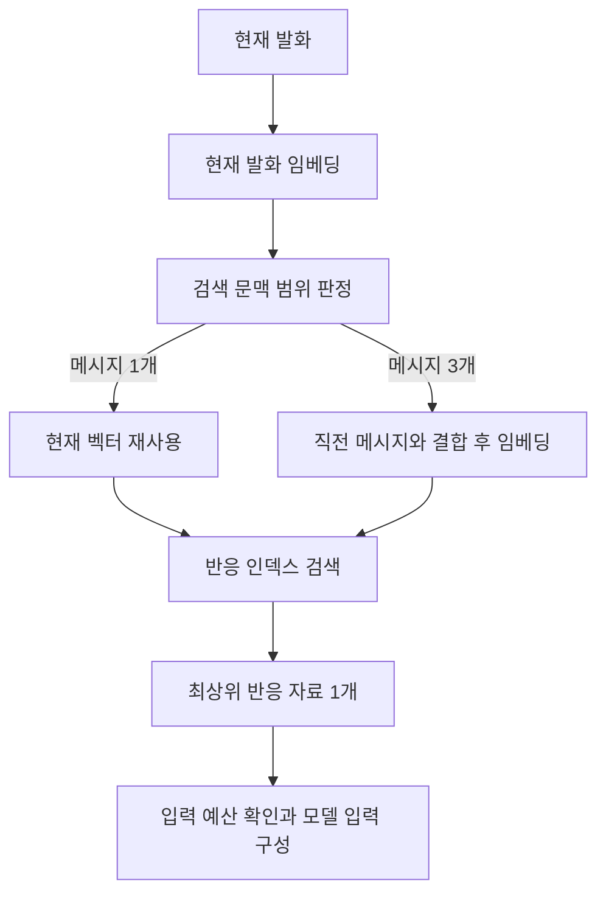

같은 짧은 발화라도 앞선 대화에 따라 뜻이 달라질 수 있습니다. 반대로 주제가 바뀐 질문에 이전 대화를 섞으면 검색기가 지난 주제에 가까운 자료를 고를 수 있습니다. 반응 검색은 이 차이를 반영해 검색 입력의 범위를 먼저 정합니다.

검색 대상은 미리 준비한 반응 자료입니다. 각 항목에는 답변의 목표, 표현 형태와 참고 예시가 있습니다. 검색 결과는 답변을 생성할 때 참고하도록 입력에 넣습니다.

## Choosing the query

현재 발화를 임베딩으로 바꾸고, 검색 범위를 고르는 판정기에 전달합니다. 판정기는 의미 유사도, 문자 유사도, 문장 길이와 지칭·회상 등의 신호를 결합합니다. 출력은 현재 메시지만 사용하는 방식과 최근 메시지까지 사용하는 방식 두 가지입니다.

| 선택 | 검색 입력 |
| --- | --- |
| 메시지 1개 | 현재 사용자 발화 |
| 메시지 3개 | 직전 메시지 최대 2개와 현재 사용자 발화 |

여기서 메시지는 사용자와 AI의 발화를 각각 한 개로 셉니다. 이전 이력이 부족하면 있는 메시지만 사용합니다.

현재 발화만 사용할 때는 판정에 사용한 임베딩을 검색에도 재사용합니다. 이력을 포함하면 합친 텍스트의 임베딩을 한 번 더 계산합니다.

## Ranking and insertion

검색기는 정규화된 질문 벡터와 인덱스 벡터의 내적을 비교해 가장 높은 점수의 자료 하나를 선택합니다. 현재 경로는 최소 유사도에 따른 기권 없이 최상위 항목을 선택합니다. 입력을 어떤 범위로 만들었는지가 검색 결과에 직접 영향을 줍니다.

선택한 자료는 배경 설정을 삽입하는 공통 코드로 전달합니다. 반응 자료는 자체 설정 예산을 우회하도록 표시되어 있지만, 입력 구성부의 전체 토큰 한도와 구성 요소별 상한은 그대로 적용됩니다.

인덱스와 판정기 자원을 읽을 때 임베딩 식별자, 벡터 차원, 파일 해시와 선택된 캐릭터를 확인합니다. 서로 다른 임베딩 공간이나 다른 캐릭터의 자료가 섞이면 준비를 실패로 처리합니다.

## Evaluation scope

검색 범위 판정, 선택된 반응 자료의 적합성, 최종 답변 품질은 각각 다른 결과입니다. 검색 범위를 맞혔어도 인덱스에 적절한 자료가 없거나 생성 모델이 참고 자료를 제대로 사용하지 못할 수 있습니다.

제품 로그에는 선택한 메시지 수, 임베딩 호출 횟수, 선택 항목과 검색 점수, 단계별 시간이 남습니다. 이 기록으로 검색 문맥을 넓힌 요청의 추가 임베딩 비용과 검색 결과를 함께 살펴볼 수 있습니다.
