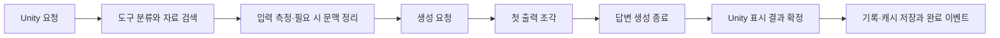

대화가 길어지면 앞선 내용을 읽는 비용과 입력 토큰 수가 함께 늘어납니다. 별무리는 고정 지침의 접두부 계산을 재사용하고, 입력 예산을 넘는 대화는 요약합니다. 검색과 요약에 걸린 시간도 사용자가 답변을 기다리는 시간에 포함됩니다.

## Input budget

제품 런타임과 평가 도구는 `slm-runtime-defaults.json`의 기본 예산을 공유합니다. 아래 값은 제품 기본값이며, 개별 실험은 별도 조건을 지정할 수 있습니다.

| 항목 | 기본 상한 |
| --- | ---: |
| 전체 컨텍스트 | 4,096토큰 |
| 생성 출력 예약 | 512토큰 |
| 고정 지침 | 1,024토큰 |
| 검색한 장기 기억 | 512토큰 |
| 배경 설정·반응 참고 등 | 512토큰 |
| 현재 화두 | 512토큰 |
| 요청별 상태 정보 | 256토큰 |
| 현재 질문 | 300토큰, 500자 |
| 대화 요약 | 500토큰 |

구성 요소별 상한은 전체 입력을 나눈 고정 배정량이 아닙니다. 각 부분의 길이를 제한한 뒤 네이티브 대화 템플릿이 적용된 전체 입력을 다시 측정합니다. 토큰화 경계와 템플릿이 있으므로 각 부분을 따로 센 값의 합이 전체 토큰 수와 같지는 않습니다.

## Context compaction

현재 입력과 출력 예약이 컨텍스트 용량을 넘으면 대화 문맥을 정리합니다. 답변을 마친 뒤에도 다음 질문의 공간까지 확보할 수 있는지 확인합니다. 문맥 정리 시 적용하는 한도는 다음과 같습니다.

$$
T_{\mathrm{prepared}} \le C - O - Q
$$

$C$는 전체 컨텍스트 용량, $O$는 출력 예약, $Q$는 다음 질문의 예약량입니다. 기본값에서는 현재 질문을 제외해 준비한 입력을 3,284토큰 안에 맞춥니다.

최근 3개 요청의 문맥을 우선 남기고, 빠지는 대화와 이전 요약으로 새 요약을 생성합니다. 최근 문맥도 길면 더 줄이며, 요약 역시 남은 예산 안으로 제한합니다. 완성된 입력을 다시 측정하고 모델에 미리 입력해 계산한 뒤 문맥 파일과 캐시를 저장합니다.

요약 생성에 실패하면 경고를 보내고 예산에 맞는 최근 문맥만 사용합니다. 파일 저장과 모델 입력 계산 실패는 준비 실패로 처리합니다. 고정 지침이나 현재 질문 자체가 상한을 넘는 오류는 대화 요약으로 해결하지 않습니다.

## Prefix reuse

요청마다 전체 입력을 구성하되, 같은 토큰 접두부의 KV를 재사용합니다. 고정 지침을 앞에 두고 요청별 문맥을 이력 뒤에 배치하면 앞부분이 바뀌는 범위를 줄일 수 있습니다.

요약으로 이력이 바뀌면 그 위치부터는 다시 계산해야 합니다. 따라서 캐시 재사용률과 요약 비용은 서로 연관됩니다. 저장·복원 구조와 기존 iPhone 비교 실험은 [KV Cache Reuse and Persistence](?doc=optimization-kv-cache)에서 설명합니다.

## Timing boundaries

런타임의 첫 출력 시간은 생성 요청부터 첫 텍스트 조각까지의 구간입니다. 그 전에 실행한 검색과 입력 구성, 문맥 정리 시간은 포함하지 않습니다. 반응 검색에서 최근 메시지를 포함한 경우에는 검색 입력을 위한 추가 임베딩도 발생합니다.

첫 조각에 기억 저장 판정 헤더만 있다면 화면에는 아직 답변이 표시되지 않습니다. 사용자 관점의 첫 응답 시간은 입력을 보낸 때부터 출력 분리와 필터를 거쳐 표시할 텍스트가 도착한 때까지 측정해야 합니다.

스트리밍 조각의 개수는 모델 토큰 수와 다릅니다. 토큰 생성 속도는 네이티브 런타임의 토큰 계측값으로 계산하며, 답변 완료 후의 문맥 정리 시간도 다음 요청 가능 시점을 설명할 때 구분합니다.
