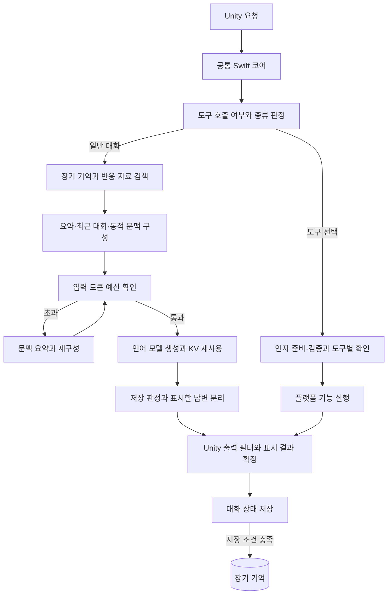

별무리의 iOS·Android 앱은 같은 Swift 대화 코어를 사용합니다. Unity는 요청과 화면 상태를 관리하고, 공통 코어는 검색, 입력 구성, 모델 생성과 기기 기능 실행을 조율합니다.

## Request flow

문맥 요약 후에도 입력을 맞출 수 없거나 정리 과정이 실패하면 요청을 오류로 끝냅니다. 도구 경로는 선택한 도구의 인자 방식과 확인 정책을 따릅니다. 현재 시각 조회처럼 인자 생성과 확인 화면을 생략하는 경로도 있습니다.

## Components and state

| 구성 요소 | 보관하거나 관리하는 상태 |
| --- | --- |
| Unity 대화 세션 | 현재 요청 ID, 화면에 표시한 답변, 취소와 필터 결과 |
| 공통 Swift 코어 | 요청 진행 상태, 선택한 캐릭터, 대화 문맥과 요약 |
| 대화 파일 | 캐릭터별 최근 이력, 요약과 확정된 요청 상태 |
| SQLite | 사용자·캐릭터 범위의 장기 기억과 날짜별 일기 |
| 추론 런타임 | 모델 엔진, 생성 세션과 재사용할 KV 상태 |
| 플랫폼 어댑터 | 모델 자산, 기기 권한과 기능별 실행 결과 |

대화 파일은 다음 요청에 사용할 내용을 결정합니다. KV 캐시는 그 내용을 모델이 처리하며 만든 계산 결과를 재사용합니다. 캐시 복원에 실패해도 대화 기록으로 입력을 구성할 수 있습니다.

## Unity boundary

Unity는 C ABI로 JSON 요청을 보내고 콜백 이벤트를 큐에서 읽습니다. iOS와 Android는 각각의 네이티브 연결부를 사용하지만 요청 처리는 공통 코어로 전달합니다.

생성이 끝나면 코어는 완료 예정 이벤트를 보내고 Unity의 표시 결과 확정을 기다립니다. 그 뒤 대화 기록을 저장하고 완료를 알립니다. 새 요청을 받을 준비와 답변 완료는 별도 상태이므로, 완료 후 문맥 요약이 진행될 수도 있습니다.

전체 구조와 실패 처리는 [Architecture](?doc=architecture)에서 설명합니다.
