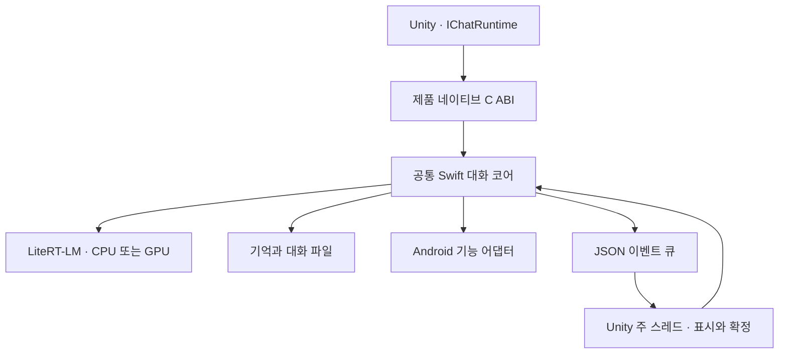

Android 제품은 Unity에서 공통 Swift 대화 코어를 호출하고 LiteRT-LM으로 답변을 생성합니다. iOS와 입력 구성, 기억 검색, 반응 자료 검색과 문맥 요약을 공유하며, 모델 파일과 기기 기능은 Android 어댑터로 연결합니다.

## Request flow

Android 호스트는 자산·모델·저장·캐시 경로와 추론 백엔드를 받아 공통 코어를 구성합니다. 요청 전송, 취소, 대화 확정과 캐릭터 전환은 C 함수로 전달합니다. Swift의 콜백은 Unity 이벤트 큐에 들어가며, Unity 주 스레드가 화면과 대화 상태를 갱신합니다.

## Main queue integration

Swift의 메인 큐 작업은 Android UI 스레드의 실행 루프인 `Looper`에 연결합니다. Android UI 스레드와 Unity 주 스레드는 서로 다르므로, Swift 작업이 실행된 뒤에도 Unity 화면 갱신은 이벤트 큐를 거칩니다.

libdispatch의 알림용 파일 디스크립터를 `ALooper_addFd`에 등록합니다. 작업 도착 알림을 받으면 먼저 `eventfd`의 알림 값을 읽고, 그다음 Swift 메인 큐의 대기 작업을 처리합니다.

이 순서가 중요합니다. 대기 작업만 처리하고 알림을 남기면 유휴 상태에서도 콜백이 반복될 수 있습니다. 반대로 작업 처리 후 알림을 읽으면 처리 중 새로 도착한 작업의 알림까지 지울 수 있습니다. 먼저 기존 알림을 소비하면 처리 중 발생한 새 알림이 다음 실행을 깨울 수 있습니다.

libdispatch 내부 함수를 사용하므로 SDK 버전을 바꿀 때 해당 심볼과 실행 동작을 함께 확인해야 합니다.

## Inference backend and cache

Android는 CPU와 GPU 추론을 지원합니다. 설정 변경은 다음 앱 실행에서 적용하며, 실행 중인 모델을 즉시 교체하지 않습니다. 초기화 시 선택한 백엔드와 네이티브 엔진 배포 프로필의 호환성을 확인합니다.

공통 런타임은 입력 접두부가 같은 구간의 KV를 재사용하고, 완료한 대화의 캐시를 저장합니다. 캐시 경로와 호환성 식별자에 백엔드를 포함해 CPU 상태를 GPU 상태로 복원하지 않도록 합니다. 자세한 복원 조건은 [KV Cache Reuse and Persistence](?doc=optimization-kv-cache)에서 설명합니다.

## Platform functions

도구 분류와 인자 검증은 공통 Swift 코어가 처리합니다. Android 어댑터는 앱 소유 알람·타이머, 일정 조회·생성, 예약 알림과 걸음 조회를 기기 기능에 연결합니다. 현재 시각 조회는 두 플랫폼이 공유하는 어댑터를 사용합니다.

기능별 지원 여부와 앱에서 허용된 기능 목록을 구분합니다. 지원되는 도구라도 필요한 권한이나 사용 조건이 충족되지 않으면 실패 결과를 반환합니다.

## Product and experiment boundaries

제품은 공통 대화 코어에 연결된 네이티브 라이브러리를 사용합니다. Unity용 PoC 스크립트와 테스트는 별도 오버레이로 관리하며 제품 빌드에 포함하지 않습니다.

아래의 메인 큐 비교는 2026년 9월 27일에 수행한 모델 없는 에뮬레이터 실험입니다. 이벤트 연결 방식을 선택한 근거이며, 현재 제품의 생성 지연이나 실기기 성능을 측정한 결과는 아닙니다.

Measurement details

2026-09-27에 Android API 36 ARM64 에뮬레이터에서 Unity `6000.6.0f1` 개발 빌드와 Swift Android SDK 6.4를 사용해 측정했습니다. 모델은 로드하지 않았습니다.

측정한 지연은 C# 백그라운드 스레드가 Swift 함수를 호출하기 직전부터 `MainActor` 작업이 C# 콜백에 도착할 때까지입니다. 언어 간 호출 비용도 이 값에 포함됩니다.

각 연결 방식으로 앱을 새로 실행해 3회 반복했습니다. 한 실행에서 추가 UI 부하가 없는 구간과 UI 부하를 추가한 구간을 순서대로 측정했습니다. 각 구간에서는 20ms 간격으로 작업 40건을 제출했습니다. 부하 구간은 Android UI 스레드에서 약 1ms 동안 계산한 뒤 자신을 다시 등록하는 작업을 연속으로 실행했습니다.

| 연결 방식 | 조건 | 관찰 시점까지 도착 | 중앙값 | p95 |
| --- | --- | ---: | ---: | ---: |
| 이벤트 | 추가 UI 부하 없음 | 120 / 120 | 2.10ms | 6.41ms |
| 이벤트 | 연속 UI 작업 | 120 / 120 | 2.19ms | 3.48ms |
| 유휴 핸들러 | 추가 UI 부하 없음 | 65 / 120 | 69.15ms | 175.06ms |
| 유휴 핸들러 | 연속 UI 작업 | 87 / 120 | 300.51ms | 570.02ms |

중앙값과 p95는 세 실행에서 관찰 시점까지 도착한 표본을 합쳐 계산했습니다. p95는 오름차순 표본의 0부터 시작하는 인덱스 `floor(0.95 × (n − 1))`에 있는 값입니다. 도착하지 않은 표본은 지연 통계에서 제외하고 도착 건수에 반영했습니다.

추가 UI 부하가 없는 구간은 제출 반복문이 끝난 뒤 400ms에 결과를 읽었습니다. 부하 구간은 제출 반복문 종료 후 300ms에 부하 종료를 요청하고, 500ms를 더 기다린 뒤 결과를 읽었습니다. 미도착은 그 관찰 시점의 상태이며 영구적인 작업 유실을 의미하지 않습니다.

이벤트 방식에서는 두 구간 모두 관찰 시점까지 모든 작업이 도착했습니다. 유휴 핸들러에서는 추가 UI 부하가 없는 구간에서도 늦게 도착하거나 아직 도착하지 않은 작업이 있었습니다. 이 측정 결과를 근거로 Swift 작업의 도착을 Android 실행 루프에 알리는 이벤트 방식을 선택했습니다.

두 구간은 같은 프로세스에서 이어서 실행했습니다. 첫 구간의 미완료 작업이 남은 상태로 다음 구간을 시작할 수 있으므로, 부하 구간의 지연이 UI 부하만으로 발생했다고 해석할 수는 없습니다. 이 수치로 두 방식의 일반적인 성능 비율을 계산하는 것도 적절하지 않습니다.

계측에서는 콜백 도착 시간을 기록했고 실행 스레드 ID는 별도로 검증하지 않았습니다. 실기기 지연·전력·장시간 안정성과 메인 스레드를 오래 점유하는 단일 작업의 영향도 측정하지 않았습니다.

[System Map](?doc=overview-system-map) · [Evaluation Boundaries](?doc=optimization-evaluation-boundaries)
