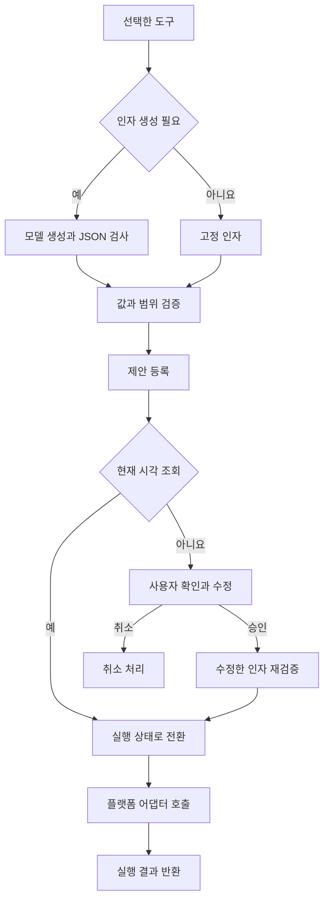

도구를 선택한 뒤에는 실제 실행에 사용할 인자를 준비합니다. 날짜, 시간이나 수량처럼 사용자의 표현을 함수가 받을 수 있는 값으로 바꾸는 단계입니다. 인자가 필요한 도구는 언어 모델이 제안하고 Swift가 검증합니다. 현재 시각과 알람 목록 조회는 코드에 정의된 고정 인자를 사용합니다.

## Generation and parsing

인자를 생성하는 경로는 선택한 도구의 정의와 전용 지침으로 대화 객체를 만듭니다. 언어 모델 엔진은 일반 대화와 공유하지만, 이 생성에는 선택된 도구 하나의 정의를 제공합니다.

모델이 반환한 호출은 도구 이름과 JSON 인자로 구성됩니다. 파서는 반환한 이름이 라우터가 선택한 도구와 일치하는지 검사합니다. 도구마다 필수 필드와 허용 필드를 확인하고, 값의 자료형도 검사합니다.

구조가 맞는 JSON에도 범위를 벗어난 시간이나 종료가 시작보다 이른 기간이 들어올 수 있습니다. 다음 단계에서는 이런 값의 유효성을 검사합니다.

## Argument validation

검증기는 도구별 조건을 적용하고 실행에 사용할 자료형으로 변환합니다. 현재 코드에는 시·분 범위, 날짜의 유효성, 기간의 순서, 일부 예약의 미래 시각 여부, 문자열 길이와 조회 범위 제한 등이 있습니다.

검증 규칙은 도구마다 다릅니다. 예를 들어 알람과 로컬 알림에는 미래 시각 검사가 있고, 일정 생성에는 시작·종료 순서 검사가 있습니다.

검증기는 일부 값을 정규화하기도 합니다. 날짜 범위를 네이티브 API에 전달할 때 마지막 날의 다음 날을 상한으로 바꾸거나, 일정의 종료 시각이 없으면 시작에서 한 시간 뒤로 설정하는 처리가 있습니다. 사용자 확인과 실행에는 이 처리를 거친 제안을 사용합니다.

## Confirmation and execution

현재 시각 조회는 확인 없이 실행합니다. 알람 목록 조회를 포함한 나머지 도구는 사용자 확인을 거칩니다. 사용자가 인자를 수정했다면 수정한 값도 검증합니다.

실행 조정자는 제안 준비, 확인 대기, 실행 중과 종료 상태를 관리합니다. 승인 실행은 확인 대기 상태에서만 허용하고, 확인을 생략하는 경로도 해당 도구의 정책을 확인합니다. 네이티브 호출을 기다리기 전에 실행 시작을 기록해 같은 요청이 중복 실행되지 않게 합니다. 이 기록은 프로세스 메모리에 유지됩니다.

플랫폼 어댑터는 공통 검증을 통과한 제안을 운영체제 호출로 변환합니다. Android에는 앱이 소유한 알람·타이머, 일정 조회·생성, 예약 알림과 걸음 조회가 연결되어 있습니다. 현재 시각 조회는 공통 어댑터에서 처리합니다. 운영체제 권한과 기능별 제약은 각 플랫폼 어댑터가 확인합니다.

## Result handling

네이티브 어댑터는 실행 결과나 오류를 반환합니다. 결과 포맷터는 언어 모델의 추가 생성 없이 이 값을 사용자가 읽을 응답으로 바꾸어 Unity에 전달합니다.

도구 응답은 최근 대화에 남지만, 일반 대화의 장기 기억 검색·저장 절차는 거치지 않습니다. 알람 생성처럼 기기에 변경을 적용한 뒤 취소가 도착하면 이미 실행한 결과를 유지합니다. 조회처럼 변경을 남기지 않는 작업과 구분하는 이유입니다.

Cancellation boundary

확인 화면을 취소하면 실행하지 않습니다. 도구 인자 생성은 일반 대화 스트리밍과 다른 생성 경로를 사용하므로, 요청 상태의 취소와 네이티브 추론 중단 시점은 구분해야 합니다.

운영체제 호출에 성공한 변경은 늦게 도착한 취소로 되돌리지 않습니다. 호출이 실패하면 성공 문장을 생성하지 않고 어댑터의 실패 결과를 반환합니다.

